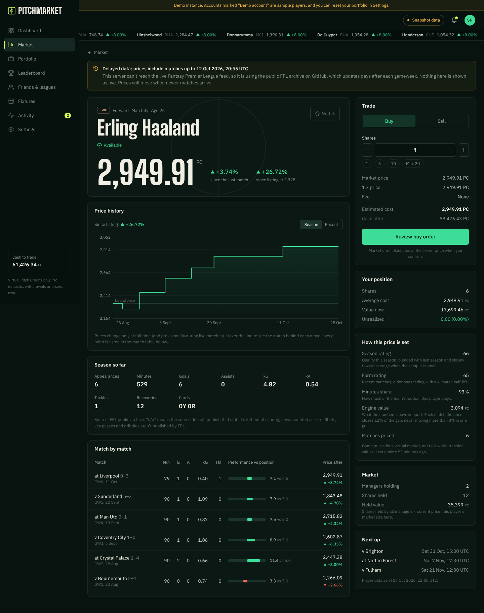
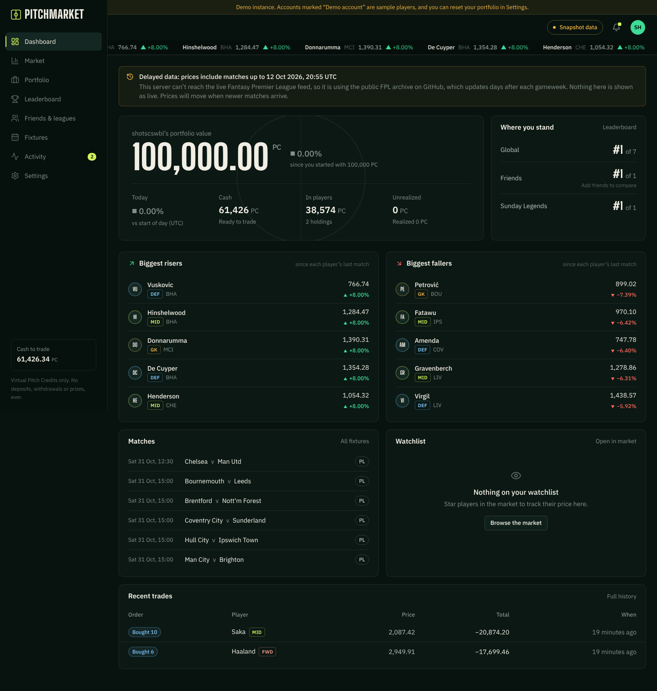
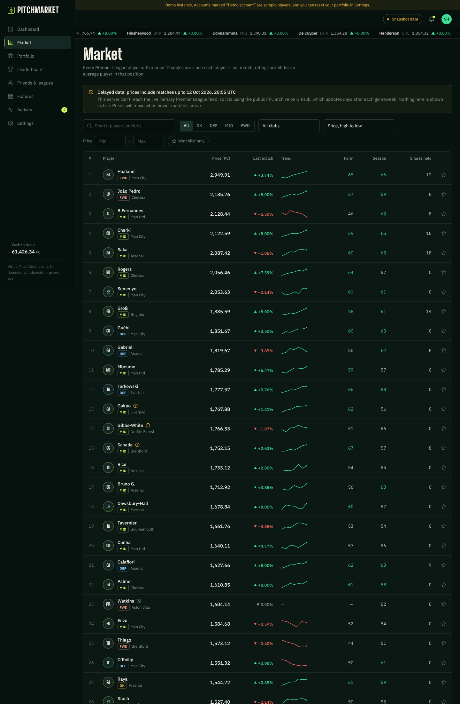
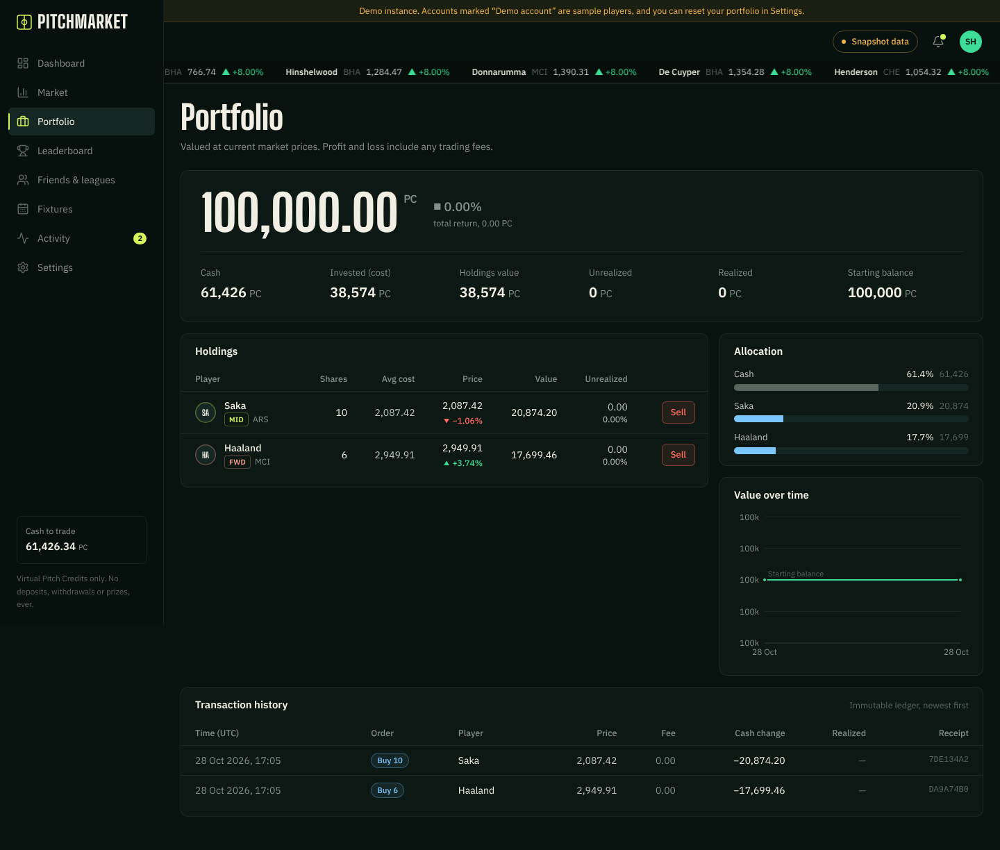
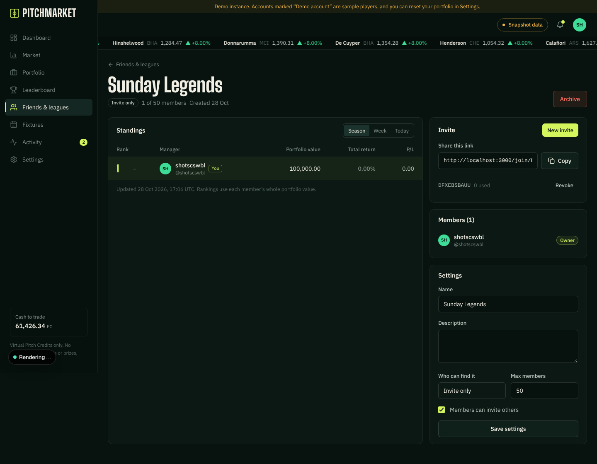

# PITCHMARKET

**A stock market where the stocks are footballers.** Buy and sell Premier League
players with 100,000 virtual Pitch Credits. Prices move after every match from
what players actually did, and you compete with friends in private leagues.

> Virtual money only. There are no deposits, withdrawals, prizes or bets. Prices
> are game prices produced by a documented engine, not real-world player valuations.



| Dashboard | Market |
|---|---|
|  |  |
| **Portfolio** | **League** |
|  |  |

## What's in it

* **Real football data.** 667 Premier League players, 380 fixtures, and
  per-player match stats (minutes, goals, assists, xG, xA, saves, clean sheets,
  tackles, recoveries, cards, availability) from the Fantasy Premier League feed.
  It falls back automatically to the public FPL archive, clearly labelled as a delayed snapshot.
* **A deterministic, documented price engine.** Position-aware match scoring
  against baselines derived from 11,498 real 2025-26 appearances, season quality
  and time-decayed form, a minutes-share (role) factor, mean reversion, and ±8% per-match caps.
  Initial prices come from last season. Every price path replays exactly.
* **A server-authoritative trading engine.** Integer-cent money, row-locked
  atomic transactions, idempotent orders, append-only ledgers enforced by
  database triggers, stale-price protection, an in-play trading lock, and market halts.
* **Portfolio** with average entry, realised and unrealised P/L, allocation,
  daily value history and an immutable transaction history with receipts.
* **Social:** friend requests, private and public leagues with revocable,
  cappable, expiring invite links (or direct invites to friends), league roles,
  privacy controls, an activity feed and notifications.
* **Leaderboards:** global, friends and league; season, week or today; rank
  movement; deterministic ties.
* **Operations:** cron-driven ingestion with retries, backoff, rate-limit
  handling, exactly-once settlement and job locks; a stale-data auto-halt;
  `/api/health`, `/api/ready`; and an admin console with provider status, runs,
  failures, ledger integrity checks and an audit log.
* **12 screens:** landing, auth and onboarding, dashboard, market, player,
  portfolio, leaderboard, friends and leagues, fixtures, activity, settings,
  admin. Plus public profiles and invite pages. Responsive down to phones.

## Quick start

Requirements: Node 20.9+ (22 recommended) and PostgreSQL 14+ (16 tested).

```bash
git clone <your repo> pitchmarket && cd pitchmarket
npm ci
cp .env.example .env            # set DATABASE_URL; for a local demo set APP_MODE=demo and SECURE_COOKIES=false
npm run db:migrate              # create the schema
npm run db:seed                 # load real players, fixtures and stats; settle finished matches
npm run dev                     # http://localhost:3000
```

Optional:

```bash
npm run db:seed -- --demo-users     # labelled demo accounts + a public Demo League (APP_MODE=demo)
npm run worker                      # keep data fresh locally (scheduler loop)
npm run admin:grant -- you@x.com    # make your account an admin (after signing up)
```

## Commands

| Command | What it does |
|---|---|
| `npm run dev` / `build` / `start` | Develop, build for production, serve the production build |
| `npm run lint` / `typecheck` | ESLint / TypeScript |
| `npm test` | Unit + integration tests (integration needs Postgres, see below) |
| `npm run test:e2e` | Playwright end-to-end (builds and serves the app on :3100) |
| `npm run check` | lint + typecheck + tests + build |
| `npm run db:generate` | Generate a SQL migration after editing `src/db/schema.ts` |
| `npm run db:migrate` / `db:seed` | Apply migrations / seed the market from real data |
| `npm run ingest [-- --force]` | Run one scheduler tick from the CLI |
| `npm run worker` | Long-running scheduler (self-hosting) |
| `npm run data:derive` | Regenerate scoring baselines and player priors from the 2025-26 season |

## Tests

```bash
createdb pitchmarket_test && createdb pitchmarket_e2e    # owned by your DATABASE_URL user
TEST_DATABASE_URL=postgres://…/pitchmarket_test npm test
E2E_DATABASE_URL=postgres://…/pitchmarket_e2e npm run test:e2e
```

Test databases are reset and seeded from a trimmed slice of real 2026-27 data in
`tests/fixtures/fpl-archive`, so tests run offline and never touch your data.

Last full run (28 Oct 2026):

* **Unit, 45 passing:** scoring per position, missing-stat handling, pricing
  caps, smoothing and replay, live no-compounding, money and rounding, valuation
  identities, provider normalisers, HTTP retry/backoff/429, text helpers.
* **Integration, 41 passing** against real Postgres: registration, sessions,
  login, reset, deletion; trades, insufficient cash and shares, P/L, idempotency,
  12-way concurrent orders with no overspend, racing duplicate submissions,
  concurrent sells, halts, in-play lock, delisting, ledger immutability,
  invariants, demo reset; seeded market replay for every player, exactly-once
  settlement, live ticks then settlement, auto-halt and reopen, job locks;
  friends (including IDOR checks), leagues (capacity, revocation, expiry, direct
  invites, roles, ownership transfer), leaderboards (ties, scopes, opt-out,
  periods), privacy.
* **End-to-end, 6 passing** (Playwright, production build): register, onboard,
  market, player, buy, portfolio, sell, history, create league, second user joins
  via link, friend request accepted, both users on friends/league/global boards,
  persistence after reload, mobile layout with no horizontal overflow, signed-out
  redirects, generic login error, 401/403 API checks, CSRF block, cron auth, unaffordable
  order blocked, forged price rejected, private league 404, invalid invite, admin forbidden.

## Data

* **Premier League, tradable.** Live from the FPL API when reachable (in-play
  updates about every minute, final stats about an hour after full time).
  Otherwise from the public archive (delayed by days), shown as "Snapshot data"
  across the app.
* **Other competitions, results only** (La Liga, Bundesliga, Serie A, Ligue 1,
  Champions League) with a free football-data.org key. The free tier has no
  player stats, so those players aren't tradable.
* See [docs/DATA_LICENSING.md](docs/DATA_LICENSING.md) for the provider
  comparison, terms and risks. The FPL API is unofficial; use a licensed feed
  for anything commercial.

## Documentation

* [Architecture, security and sources of truth](docs/ARCHITECTURE.md)
* [Market mechanics: scoring, pricing, orders, leaderboards](docs/MARKET_MECHANICS.md)
* [Deployment: Render + Neon (free), Vercel, any Node host; free-tier budgets](docs/DEPLOYMENT.md)
* [Data sources, licensing and attribution](docs/DATA_LICENSING.md)
* [Troubleshooting](docs/TROUBLESHOOTING.md)

## Renaming

Set `APP_NAME` to rename the product everywhere (wordmark, titles, emails). The
name "PITCHMARKET" only appears elsewhere in documentation.

## Known limitations

* No email verification, so one person can create several accounts (sign-ups are
  rate-limited per IP). Password-reset emails need `RESEND_API_KEY` in production.
* Free data gives tradable players for the Premier League only. More leagues need
  a licensed per-player feed (adapter interface in `src/server/ingestion/providers/types.ts`).
* Market orders only. Limit orders aren't implemented.
* Live UI updates poll every 20 s (no websockets), which is suitable for serverless hosting.
* On sleep-on-idle free hosts (Render free) the first visit after a quiet spell
  takes up to a minute while the server wakes. Around matches the server keeps
  itself awake; serverless hosts (Vercel) need an external per-minute cron for
  live pricing (see the deployment guide).
